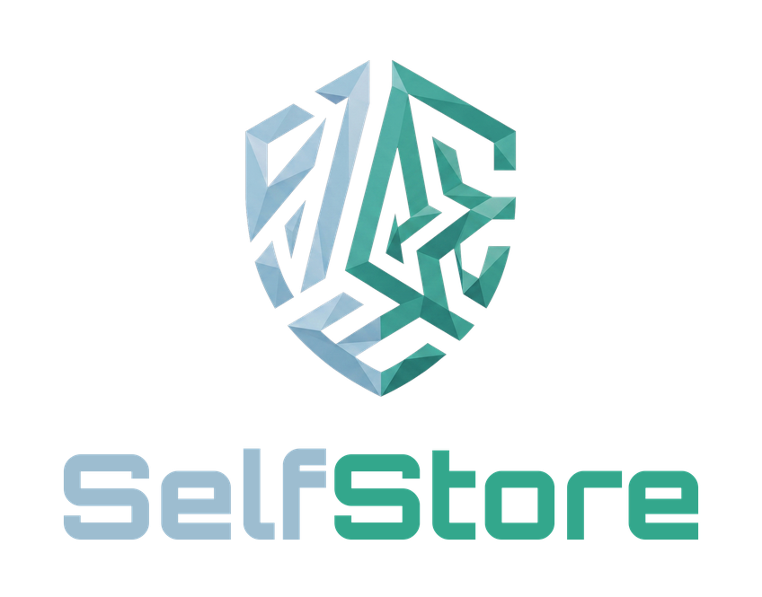

<div align="center">



**Your own app store for all Self projects — without Google Play.**<br>
*Dein eigener App-Store für alle Self-Projekte — ohne Google Play.*

[](https://github.com/s3lfcod3r/selfstore/actions/workflows/sync-catalog.yml)
[](https://github.com/s3lfcod3r/selfstore/releases/latest)
[](LICENSE)
[](https://store.selfcoder.de/)


**[🇬🇧 English](#-english) · [🇩🇪 Deutsch](#-deutsch)**

📰 **What's new / Neuigkeiten** → [CHANGELOG.md](CHANGELOG.md)

</div>

---

<a id="-english"></a>

## 🇬🇧 English

SelfStore is a **lean, self-hosted app store** exclusively for the **Self projects**. A native Android app reads a fixed catalog from GitHub and installs/updates the apps directly on your **phone and TV box** — ideal for boxes that have no Google Play, or where it isn't wanted. It is **not** a public store: no third-party repos, only your own Self apps. → [**Open store**](https://store.selfcoder.de/)

This repository provides the **server side** (catalog + bootstrap landing page + pairing page) via GitHub Pages. The Android app's source code is maintained separately and is not part of this repo.

Part of the **Self** family (SelfMailer, SelfAuthenticator, SelfDashboard …) — same design system, same deploy style (GitHub Releases → SelfStore).

> **TL;DR** — fixed catalog of Self apps · install/update without Google Play · Android TV (Leanback) · armv7 + armv8 · custom sources (NextCloud/WebDAV) · end-to-end encrypted web pairing · signature pinning + SHA-256 check · runs entirely on GitHub.

### 📑 Table of contents

[Features](#en-features) · [Included apps](#en-apps) · [Architecture](#en-architecture) · [Catalog sync](#en-catalog-sync) · [Add an app](#en-add-app) · [Quick start](#en-quick-start) · [Configuration](#en-configuration) · [Android app](#en-android) · [Security](#en-security) · [Tech stack](#en-tech-stack) · [Development](#en-development) · [Roadmap](#en-roadmap)

<a id="en-features"></a>

### ✨ Features

**📦 Store**
- **One fixed store** — only your own Self apps, no third-party repos
- **Update detection** — shows *Install · Open · Update* per device state
- **armv7 + armv8** — automatically picks the right APK per box
- **Device filter** — on a TV only TV-capable apps are shown; phone-only apps stay hidden there (catalog field `platforms`)
- **No own server needed** — catalog + APKs run entirely on GitHub

**📺 TV**
- **TV-ready** — appears on the Android TV home (Leanback), remote-friendly
- **Add via web** — enter a source in the browser on your PC/phone (`store.selfcoder.de/pair`); the TV box picks it up automatically via a code — no typing on the remote. → [setup](docs/WEB-KOPPLUNG-SETUP.en.md)

**🔐 Security & platform**
- **Custom sources** — add private app repos (e.g. NextCloud/WebDAV) with username + app password; credentials stored encrypted (Android Keystore), HTTPS only. → [guide](docs/EIGENE-QUELLEN.en.md)
- **End-to-end encrypted pairing** (since v1.5.0) — the two-part code `SLOT-KEY` sends only the slot to the service, leaving link and password unreadable to it
- **Self branding** — consistent Self look (teal, dark)

<a id="en-apps"></a>

### 📲 Included apps

The current list lives in [`catalog.json`](catalog.json) and is live at
**<https://store.selfcoder.de/catalog.json>**.

| App | Purpose |
|---|---|
| **SelfStore** | The store itself (self-update) |
| **SelfMailer** | Self-hosted mail client (IMAP/SMTP, calendar) |
| **SelfAuthenticator** | Zero-knowledge 2FA / TOTP vault |
| **SelfDashboard** | Central overview of your Self services |
| **SelfPoolTracker** | Your pool water values under control |
| **SelfWG** | WireGuard that stays up |
| **SelfGuard** | Device check for spyware, ad blocker included |
| **SelfRemote** | Let this device be supported remotely |

<a id="en-architecture"></a>

### 🧭 Architecture

```text
   ┌────────────────────────────── GitHub ───────────────────────────────┐
   │  GitHub Pages                          GitHub Releases              │
   │  catalog.json + landing page           signed APKs (per app repo)   │
   └──────────────▲────────────────────────────────────▲─────────────────┘
                  │ reads catalog (HTTPS)               │ downloads matching APK (ABI)
           ┌──────┴─────────────────────────────────────┴──────┐
           │            SelfStore app (Android / TV)           │
           └─────────────────────────┬─────────────────────────┘
                                     │ system installer
                              ┌──────▼──────┐
                              │ box / phone │
                              └─────────────┘
```

- **Catalog** = static `catalog.json` (this repo, via GitHub Pages).
- **Delivery** = APKs as **GitHub release assets** per app repo.
- **Client** = native Compose app, picks the right APK via `Build.SUPPORTED_ABIS`.

<a id="en-catalog-sync"></a>

### 🤖 Automatic catalog sync

A GitHub workflow ([`.github/workflows/sync-catalog.yml`](.github/workflows/sync-catalog.yml))
keeps the **versions of existing apps** up to date automatically: it periodically
(every 15 min, on every release, and manually via *Run workflow*) reads the latest
release of each app repo, pulls `versionCode`/`versionName`/`applicationId` straight
from the release APK, computes its **SHA-256** and updates `catalog.json`. The app
verifies that hash before every installation.

Requirement per entry: a **`"source": "<owner>/<repo>"`** field (ignored by the app).
So for updates: **build APK → upload release → done** — the catalog follows on its own.

> **💡 Tip:** **new apps** still have to be added **once by hand** (name, description, icon, correct
> `id`/`applicationId`, `source`) — see [Add an app](#en-add-app). After that their version updates run automatically.

<a id="en-add-app"></a>

### ➕ Add an app to the store

Append a block in [`catalog.json`](catalog.json) → `apps` (step-by-step guide: [docs/NEUE-APP.en.md](docs/NEUE-APP.en.md)):

```json
{
  "id": "com.example.app",
  "name": "SelfExample",
  "tagline": "Short description",
  "description": "Longer text …",
  "icon": "icons/self-example.png",
  "category": "Tools",
  "author": "SelfCoder",
  "versionName": "1.0.0",
  "versionCode": 1,
  "apk": "https://github.com/s3lfcod3r/<repo>/releases/download/v1.0.0/<file>.apk"
}
```

> **⚠️ `id` MUST be the real `applicationId`** of the app, otherwise update detection
> won't work. When unsure, read it from the APK:
> `aapt dump badging <app>.apk | findstr package`.
> Bump `versionCode` on **every** update.

#### armv7 / armv8

- **Apps without native code** (WebView wrappers, pure Compose apps): a single
  **universal APK** in the `apk` field is enough — runs on armv7 **and** armv8.
- **Apps with native libs** (`.so`): use the `abis` field instead of `apk`:

```json
"abis": {
  "armeabi-v7a": "https://…/app-armeabi-v7a.apk",
  "arm64-v8a":   "https://…/app-arm64-v8a.apk"
}
```

#### Release convention (APK file names)

Upload **two assets** per release:

- **`<App>-v<Version>.apk`** (versioned) — linked in the catalog, consistent with the
  other Self apps.
- **`selfstore.apk`** (stable name, this repo only) — so the bootstrap link
  `…/releases/latest/download/selfstore.apk` always works.

> **💡 Tip:** `latest/download/<name>` only works with a **stable** file name; link versioned
> files via `releases/download/<tag>/<file>`.

<a id="en-quick-start"></a>

### 🚀 Quick start (TV box)

1. Allow **"install unknown apps"** on the box (Settings → Security, or confirm later
   during install).
2. Install the **"Downloader"** app (by AFTVnews) from the box's store.
3. In Downloader, open this address:

```text
store.selfcoder.de
```

4. Download and install the **SelfStore APK**.

Open SelfStore → all Self apps are ready to install / update.

<a id="en-configuration"></a>

### ⚙️ Configuration

No environment variables — everything lives in [`catalog.json`](catalog.json). Fields per app (checked by `tools/check_catalog.js`):

| Field | Required | Default | Purpose |
|---|---|---|---|
| `id` | ✅ | – | Real `applicationId` of the app |
| `name` | ✅ | – | Display name |
| `apk` / `abis` | ✅ (one of them) | – | HTTPS link to the universal APK, or per-ABI links |
| `sha256` | ✅ with `apk` | – | Hash of the APK, checked before install (maintained by the auto-sync) |
| `versionName` | – | – | SemVer version shown in the store |
| `versionCode` | – | – | Must go up on every update |
| `platforms` | – | empty = everywhere | e.g. `["phone","tv"]` — device filter |
| `source` | – | – | `<owner>/<repo>` for the auto-sync (ignored by the app) |
| `i18n` | – | – | Per-language `tagline`/`description`/`category` for the landing page only |

At top level, `pairEndpoint` sets the pairing service used by **Add via web**.

#### GitHub Pages (one-time)

Settings → **Pages** → Source: `Deploy from a branch`, branch `main` / `/ (root)`.
Live after ~1 min at `https://store.selfcoder.de/` (custom domain via `CNAME`).

> **⚠️ Catalog URL:** the app loads `https://raw.githubusercontent.com/s3lfcod3r/selfstore/main/catalog.json`
> (`CATALOG_URL` in `Catalog.kt`), falling back to `https://store.selfcoder.de/catalog.json`.
> Different repo/path → adjust it there.

<a id="en-android"></a>

### 📱 Android app

A native **Jetpack Compose** client — runs on phones, tablets and **Android TV** (Leanback launcher).

- Picks the right APK per device via `Build.SUPPORTED_ABIS` (armv7 / armv8)
- Shows *Install · Open · Update* per app; on a TV only apps whose `platforms` contain `tv` (or are empty)
- **Background update check** (WorkManager, about twice a day) with a notification — installing always needs your confirmation
- **Custom sources** and **Add via web** — guides: [custom sources](docs/EIGENE-QUELLEN.en.md) · [web pairing](docs/WEB-KOPPLUNG-SETUP.en.md)
- Verifies **signature, package name and SHA-256** before handing an APK to the system installer

<a id="en-security"></a>

### 🛡️ Security

Last reviewed: **August 2026** (code **and** operations). **Hardening applied:**

- **Signature pinning (since v1.5.0):** an APK is installed only if it carries the
  expected signing key. The fingerprints live **inside the app** (`SignerPins.kt`),
  deliberately **not** in the catalog — anyone able to tamper with the catalog would
  simply change an expected value stored there. Apps without a pin (private sources)
  are checked against the signature of the already installed version.
- **Integrity before install:** package name **and** the catalog's SHA-256 are verified
  against the downloaded file; on mismatch it is deleted before the system installer
  ever sees it. The hash is maintained by the auto-sync.
- **Transport:** catalog, APKs and icons **over HTTPS only**, and only from allowed
  hosts (`github.com`, `github.io`, `githubusercontent.com`, your own source hosts).
  The address actually reached **after redirects** is re-checked, so redirects cannot
  bypass the allow-list.
- **End-to-end encrypted web pairing (since v1.5.0):** the TV shows `SLOT-KEY`; only
  the slot reaches the pairing service, while the key part travels solely through the
  user's eyes into the browser. There, link and password are encrypted with AES-256-GCM
  (PBKDF2-HMAC-SHA256, 200,000 rounds) — **the relay only ever sees ciphertext**.
  Unencrypted submissions are rejected.
- **Credentials for custom sources** are stored in `EncryptedSharedPreferences`
  (Android keystore), never in plaintext.
- **Supply chain:** the auto-sync job can write the catalog and the bootstrap APK, so
  GitHub Actions are pinned to **commit SHAs** and the Python dependencies are nailed
  down in `tools/requirements.txt` with `--require-hashes`; the repository's default
  workflow token is `read`.
- **Web pages:** catalog rendering is **XSS-safe** (`textContent` instead of
  `innerHTML`), `https:`-only links, a strict **CSP** with no inline script — including
  the pairing page where passwords are typed — and `referrer: no-referrer`.
- **App manifest:** `allowBackup=false`, FileProvider limited to `cache/downloads` and
  not exported, no cleartext, and **no** `QUERY_ALL_PACKAGES` (a narrow `<queries>` list
  instead, which also avoids Play Protect warnings).
- **Deliberate trade-offs** (documented):
  - The pairing service runs on Cloudflare — but with end-to-end encryption it is just
    a mailbox with no visibility. Its rate limit is per IP and not atomic.
  - Keystore/passwords stay **local only** and are in `.gitignore` — never in the repo.
  - GitHub Pages cannot set HTTP headers, so `frame-ancestors` is unavailable by design
    (a meta CSP cannot express it).

Found a security issue? Please report it privately / directly to SelfCoder, not in public.

Security update history → [CHANGELOG.md](CHANGELOG.md) (entries marked 🔒).

<a id="en-tech-stack"></a>

### 🧱 Tech stack

| Part | Tech |
|---|---|
| App | Kotlin · Jetpack Compose · OkHttp · Coil · WorkManager · EncryptedSharedPreferences |
| Web | Static HTML/JS · GitHub Pages · 12-language landing page (i18n) |
| Pairing | Cloudflare Worker · AES-256-GCM (in the browser) |
| Catalog tooling | Python (`sync_catalog.py`) · Node (`check_catalog.js`) · GitHub Actions |
| Delivery | GitHub Releases · custom domain `store.selfcoder.de` |

<a id="en-development"></a>

### 🛠️ Development

#### Repository contents

```text
selfstore/
├── catalog.json              # app list (source of truth)
├── index.html                # bootstrap landing page (Self look)
├── app.js                    # landing logic (renders the catalog XSS-safe)
├── pair/                     # pairing page (DE/EN) + Cloudflare Worker
├── docs/                     # guides, each as NAME.md (DE) + NAME.en.md (EN)
├── icons/                    # app icons (512×512, dark Self background)
├── tools/
│   └── sync_catalog.py       # auto-sync: pulls release versions into catalog.json
├── .github/workflows/
│   └── sync-catalog.yml      # auto-sync workflow (every 15 min + on release)
├── LICENSE                   # All rights reserved / Alle Rechte vorbehalten
└── .nojekyll                 # GitHub Pages: serve files as-is
```

```bash
# check the catalog (also runs in the sync workflow)
node tools/check_catalog.js
# helper to add a new app
python tools/add_app.py <new-app.json>
```

**Tests:**

```bash
node tests/test_check_catalog.js
python -m unittest discover -s tests -p 'test_*.py'
```

#### Build the Android app

Build via the bundled toolchain (no Android Studio needed):

```powershell
$env:JAVA_HOME    = "<TOOLCHAIN>\jdk21"
$env:ANDROID_HOME = "<TOOLCHAIN>\sdk"
& "<TOOLCHAIN>\gradle-8.10.2\bin\gradle.bat" `
    -p "<PATH-TO-APP>" `
    :app:assembleRelease --no-daemon --console=plain
```

→ `app/build/outputs/apk/release/app-release.apk` (release-signed if
`keystore.properties` exists; otherwise debug fallback).

> **⚠️ Force the v1 signature.** Older, stripped-down TV ROMs can only read the
> signature of an APK **file** if it carries a v1 (JAR) block — since signature
> pinning was added, installation fails there otherwise. `enableV1Signing = true`
> in Gradle is NOT enough: both AGP and `apksigner` skip v1 when `minSdk >= 24`.
> Re-sign the APK after building:
>
> ```bash
> apksigner sign --ks <keystore.jks> --ks-key-alias <alias> \
>   --min-sdk-version 21 \
>   --v1-signing-enabled true --v2-signing-enabled true --v3-signing-enabled true \
>   --out SelfStore-v<version>.apk app-release.apk
> ```
>
> `--min-sdk-version 21` is the decisive part — without it v1 stays off.
> Verify afterwards: `apksigner verify --verbose <apk>` must report `v1 scheme … true`.

<a id="en-roadmap"></a>

### 🗺️ Roadmap

- [x] Fixed catalog + bootstrap landing page on GitHub Pages (own domain)
- [x] Automatic catalog sync with SHA-256 integrity check
- [x] Custom sources (NextCloud/WebDAV) · device filter (TV vs. phone)
- [x] Add via web (pairing) — end-to-end encrypted since v1.5.0
- [x] Background update check with notification
- [x] Signature pinning · pinned CI · strict CSP
- [x] Landing page in 12 languages
- [ ] Atomic rate limit for the pairing service

<p align="right"><a href="#-english">⬆ back to top</a></p>

---

<a id="-deutsch"></a>

## 🇩🇪 Deutsch

SelfStore ist ein **schlanker, selbstgehosteter App-Store** ausschließlich für die **Self-Projekte**. Eine native Android-App liest einen festen Katalog von GitHub und installiert bzw. aktualisiert die Apps direkt auf **Handy und TV-Box** — ideal für Boxen, auf denen es kein Google Play gibt oder es gar nicht erwünscht ist. Er ist **kein** öffentlicher Store: keine Fremd-Repos, nur deine eigenen Self-Apps. → [**Store öffnen**](https://store.selfcoder.de/)

Dieses Repository liefert die **Server-Seite** (Katalog + Bootstrap-Landingpage + Kopplungsseite) über GitHub Pages. Der Quellcode der Android-App wird separat gepflegt und ist nicht Teil dieses Repos.

Teil der **Self**-Familie (SelfMailer, SelfAuthenticator, SelfDashboard …) — gleiches Design-System, gleicher Deploy-Stil (GitHub Releases → SelfStore).

> **Kurz** — fester Katalog der Self-Apps · installieren/aktualisieren ohne Google Play · Android TV (Leanback) · armv7 + armv8 · eigene Quellen (NextCloud/WebDAV) · Ende-zu-Ende-verschlüsselte Web-Kopplung · Signatur-Pinning + SHA-256-Prüfung · läuft komplett über GitHub.

### 📑 Inhaltsverzeichnis

[Funktionen](#de-funktionen) · [Enthaltene Apps](#de-apps) · [Architektur](#de-architektur) · [Katalog-Sync](#de-katalog-sync) · [App hinzufügen](#de-app-hinzufuegen) · [Schnellstart](#de-schnellstart) · [Konfiguration](#de-konfiguration) · [Android-App](#de-android) · [Sicherheit](#de-sicherheit) · [Tech-Stack](#de-tech-stack) · [Entwicklung](#de-entwicklung) · [Roadmap](#de-roadmap)

<a id="de-funktionen"></a>

### ✨ Funktionen

**📦 Store**
- **Ein fester Store** — nur deine eigenen Self-Apps, keine Fremd-Repos
- **Update-Erkennung** — zeigt *Installieren · Öffnen · Aktualisieren* je Gerätelage
- **armv7 + armv8** — wählt automatisch die passende APK je Box
- **Geräte-Filter** — auf dem Fernseher erscheinen nur TV-taugliche Apps; reine Handy-Apps bleiben dort ausgeblendet (Katalog-Feld `platforms`)
- **Kein eigener Server nötig** — Katalog + APKs laufen komplett über GitHub

**📺 TV**
- **TV-tauglich** — erscheint im Android-TV-Start (Leanback), per Fernbedienung bedienbar
- **Per Web hinzufügen** — Quelle am PC/Handy im Browser (`store.selfcoder.de/pair`) eingeben; die TV-Box übernimmt sie per Code automatisch, kein Tippen auf der Fernbedienung. → [Einrichtung](docs/WEB-KOPPLUNG-SETUP.md)

**🔐 Sicherheit & Plattform**
- **Eigene Quellen** — private App-Repos (z. B. NextCloud/WebDAV) mit Benutzer + App-Passwort einbinden; Zugangsdaten verschlüsselt gespeichert (Android-Keystore), nur HTTPS. → [Anleitung](docs/EIGENE-QUELLEN.md)
- **Ende-zu-Ende-verschlüsselte Kopplung** (ab v1.5.0) — der zweiteilige Code `SLOT-SCHLUESSEL` schickt nur den Slot an den Dienst, Link und Passwort bleiben für ihn unlesbar
- **Self-Branding** — durchgängig im Self-Look (Teal, dunkel)

<a id="de-apps"></a>

### 📲 Enthaltene Apps

Die aktuelle Liste steht in [`catalog.json`](catalog.json) und ist live unter
**<https://store.selfcoder.de/catalog.json>**.

| App | Zweck |
|---|---|
| **SelfStore** | Der Store selbst (aktualisiert sich selbst) |
| **SelfMailer** | Selbstgehosteter Mail-Client (IMAP/SMTP, Kalender) |
| **SelfAuthenticator** | Zero-Knowledge-2FA-/TOTP-Tresor |
| **SelfDashboard** | Zentrale Übersicht über deine Self-Dienste |
| **SelfPoolTracker** | Deine Pool-Wasserwerte im Griff |
| **SelfWG** | WireGuard, der oben bleibt |
| **SelfGuard** | Geräte-Check auf Spyware, Werbeblocker inklusive |
| **SelfRemote** | Dieses Gerät fernwarten lassen |

<a id="de-architektur"></a>

### 🧭 Architektur

```text
   ┌────────────────────────────── GitHub ───────────────────────────────┐
   │  GitHub Pages                          GitHub Releases              │
   │  catalog.json + Landingpage            signierte APKs (je App-Repo) │
   └──────────────▲────────────────────────────────────▲─────────────────┘
                  │ liest Katalog (HTTPS)               │ lädt passende APK (ABI)
           ┌──────┴─────────────────────────────────────┴──────┐
           │            SelfStore-App (Android / TV)           │
           └─────────────────────────┬─────────────────────────┘
                                     │ System-Installer
                              ┌──────▼──────┐
                              │ Box / Handy │
                              └─────────────┘
```

- **Katalog** = statisches `catalog.json` (dieses Repo, via GitHub Pages).
- **Auslieferung** = APKs als **GitHub-Release-Assets** je App-Repo.
- **Client** = native Compose-App, wählt per `Build.SUPPORTED_ABIS` die richtige APK.

<a id="de-katalog-sync"></a>

### 🤖 Automatischer Katalog-Sync

Ein GitHub-Workflow ([`.github/workflows/sync-catalog.yml`](.github/workflows/sync-catalog.yml))
hält die **Versionen bestehender Apps** automatisch aktuell: er liest periodisch
(alle 15 Min, bei jedem Release und manuell per *Run workflow*) das neueste Release
jedes App-Repos, zieht `versionCode`/`versionName`/`applicationId` direkt aus dem
Release-APK, berechnet dessen **SHA-256** und aktualisiert `catalog.json`. Den Hash
prüft die App vor jeder Installation.

Voraussetzung je Eintrag: ein Feld **`"source": "<owner>/<repo>"`** (von der App
ignoriert). Damit gilt für Updates: **APK bauen → Release hochladen → fertig** — der
Katalog zieht von selbst nach.

> **💡 Tipp:** **neue Apps** müssen weiterhin **einmalig von Hand** angelegt werden (Name,
> Beschreibung, Icon, korrekte `id`/`applicationId`, `source`) — siehe [App hinzufügen](#de-app-hinzufuegen). Danach laufen ihre Versions-Updates automatisch.

<a id="de-app-hinzufuegen"></a>

### ➕ Eine App in den Store legen

Block in [`catalog.json`](catalog.json) → `apps` anhängen (Schritt-für-Schritt-Anleitung: [docs/NEUE-APP.md](docs/NEUE-APP.md)):

```json
{
  "id": "com.beispiel.app",
  "name": "SelfBeispiel",
  "tagline": "Kurzbeschreibung",
  "description": "Längerer Text …",
  "icon": "icons/self-beispiel.png",
  "category": "Tools",
  "author": "SelfCoder",
  "versionName": "1.0.0",
  "versionCode": 1,
  "apk": "https://github.com/s3lfcod3r/<repo>/releases/download/v1.0.0/<datei>.apk"
}
```

> **⚠️ `id` MUSS die echte `applicationId`** der App sein, sonst funktioniert die
> Update-Erkennung nicht. Im Zweifel aus der APK auslesen:
> `aapt dump badging <app>.apk | findstr package`.
> `versionCode` bei **jedem** Update hochzählen.

#### armv7 / armv8

- **Apps ohne Native-Code** (WebView-Wrapper, reine Compose-Apps): ein
  **Universal-APK** im Feld `apk` reicht — läuft auf armv7 **und** armv8.
- **Apps mit Native-Libs** (`.so`): statt `apk` das Feld `abis` nutzen:

```json
"abis": {
  "armeabi-v7a": "https://…/app-armeabi-v7a.apk",
  "arm64-v8a":   "https://…/app-arm64-v8a.apk"
}
```

#### Release-Konvention (APK-Dateinamen)

Pro Release **zwei Assets** hochladen:

- **`<App>-v<Version>.apk`** (versioniert) — wird im Katalog verlinkt, einheitlich
  mit den anderen Self-Apps.
- **`selfstore.apk`** (stabiler Name, nur dieses Repo) — damit der Bootstrap-Link
  `…/releases/latest/download/selfstore.apk` immer funktioniert.

> **💡 Tipp:** `latest/download/<name>` klappt nur mit **stabilem** Dateinamen; versionierte
> Dateien per `releases/download/<tag>/<datei>` verlinken.

<a id="de-schnellstart"></a>

### 🚀 Schnellstart (TV-Box)

1. Auf der Box **„Unbekannte Apps zulassen“** erlauben (Einstellungen → Sicherheit,
   bzw. später beim Installieren bestätigen).
2. Die App **„Downloader“** (von AFTVnews) aus dem Box-Store installieren.
3. In Downloader diese Adresse öffnen:

```text
store.selfcoder.de
```

4. **SelfStore-APK** herunterladen und installieren.

SelfStore öffnen → alle Self-Apps stehen zum Installieren / Aktualisieren bereit.

<a id="de-konfiguration"></a>

### ⚙️ Konfiguration

Keine Umgebungsvariablen — alles steht in [`catalog.json`](catalog.json). Felder je App (geprüft von `tools/check_catalog.js`):

| Feld | Pflicht | Standard | Zweck |
|---|---|---|---|
| `id` | ✅ | – | Echte `applicationId` der App |
| `name` | ✅ | – | Anzeigename |
| `apk` / `abis` | ✅ (eins davon) | – | HTTPS-Link zur Universal-APK oder Links je ABI |
| `sha256` | ✅ bei `apk` | – | Hash der APK, wird vor der Installation geprüft (pflegt der Auto-Sync) |
| `versionName` | – | – | SemVer-Version, die im Store angezeigt wird |
| `versionCode` | – | – | Muss bei jedem Update steigen |
| `platforms` | – | leer = überall | z. B. `["phone","tv"]` — Geräte-Filter |
| `source` | – | – | `<owner>/<repo>` für den Auto-Sync (von der App ignoriert) |
| `i18n` | – | – | `tagline`/`description`/`category` je Sprache, nur für die Landingpage |

Auf oberster Ebene legt `pairEndpoint` den Pairing-Dienst für **Per Web hinzufügen** fest.

#### GitHub Pages (einmalig)

Settings → **Pages** → Source: `Deploy from a branch`, Branch `main` / `/ (root)`.
Live nach ~1 Min unter `https://store.selfcoder.de/` (eigene Domain per `CNAME`).

> **⚠️ Katalog-Adresse:** die App lädt `https://raw.githubusercontent.com/s3lfcod3r/selfstore/main/catalog.json`
> (`CATALOG_URL` in `Catalog.kt`), ersatzweise `https://store.selfcoder.de/catalog.json`.
> Anderes Repo / anderer Pfad → dort anpassen.

<a id="de-android"></a>

### 📱 Android-App

Ein nativer **Jetpack-Compose**-Client — läuft auf Handy, Tablet und **Android TV** (Leanback-Startbildschirm).

- Wählt per `Build.SUPPORTED_ABIS` die passende APK je Gerät (armv7 / armv8)
- Zeigt *Installieren · Öffnen · Aktualisieren* je App; auf dem Fernseher nur Apps, deren `platforms` `tv` enthält (oder leer ist)
- **Update-Prüfung im Hintergrund** (WorkManager, ca. 2× täglich) mit Benachrichtigung — installiert wird immer erst nach deiner Bestätigung
- **Eigene Quellen** und **Per Web hinzufügen** — Anleitungen: [Eigene Quellen](docs/EIGENE-QUELLEN.md) · [Web-Kopplung](docs/WEB-KOPPLUNG-SETUP.md)
- Prüft **Signatur, Paketname und SHA-256**, bevor eine APK an den System-Installer geht

<a id="de-sicherheit"></a>

### 🛡️ Sicherheit

Zuletzt geprüft: **August 2026** (Code **und** Betrieb). **Umgesetzte Härtungen:**

- **Signatur-Pinning (ab v1.5.0):** Eine APK wird nur installiert, wenn sie mit dem
  erwarteten Schlüssel signiert ist. Die Fingerabdrücke stecken **fest in der App**
  (`SignerPins.kt`), bewusst **nicht** im Katalog — wer den Katalog manipulieren
  könnte, würde einen dort hinterlegten Wert sonst einfach mitändern. Apps ohne Pin
  (private Quellen) werden gegen die Signatur der installierten Version geprüft.
- **Integrität vor der Installation:** Paketname **und** SHA-256 aus dem Katalog
  werden gegen die heruntergeladene Datei geprüft; bei Abweichung wird sie gelöscht,
  bevor der System-Installer sie zu sehen bekommt. Den Hash pflegt der Auto-Sync.
- **Transport:** Katalog, APKs und Icons **ausschließlich über HTTPS** und nur von
  erlaubten Hosts (`github.com`, `github.io`, `githubusercontent.com`, eigene
  Quell-Hosts). Auch die **nach Weiterleitungen** tatsächlich erreichte Adresse wird
  erneut geprüft — Redirects können die Freigabe nicht umgehen.
- **Web-Kopplung Ende-zu-Ende verschlüsselt (ab v1.5.0):** Der Fernseher zeigt
  `SLOT-SCHLUESSEL`; nur der Slot erreicht den Pairing-Dienst, der Schlüsselteil
  gelangt ausschließlich über die Augen des Nutzers in den Browser. Dort werden Link
  und Passwort mit AES-256-GCM verschlüsselt (PBKDF2-HMAC-SHA256, 200 000 Runden) —
  **der Relay-Betreiber sieht nur Geheimtext**. Unverschlüsselte Beiträge lehnt der
  Dienst ab.
- **Zugangsdaten eigener Quellen** liegen in `EncryptedSharedPreferences`
  (Android-Keystore), nie im Klartext.
- **Lieferkette:** Der Auto-Sync-Job hat Schreibrechte auf Katalog und Bootstrap-APK,
  deshalb sind GitHub Actions auf **Commit-SHA** gepinnt und die Python-Abhängigkeiten
  über `tools/requirements.txt` mit `--require-hashes` festgenagelt; das
  Standard-Token des Repos steht auf `read`.
- **Webseiten:** Katalog-Rendering **XSS-sicher** (`textContent` statt `innerHTML`),
  nur `https:`-Links, strikte **CSP** ohne Inline-Skript — auch auf der
  Pairing-Seite, auf der Passwörter eingegeben werden — und `referrer: no-referrer`.
- **App-Manifest:** `allowBackup=false`, FileProvider auf `cache/downloads` beschränkt
  und nicht exportiert, kein Cleartext, **kein** `QUERY_ALL_PACKAGES` (stattdessen
  enge `<queries>`-Liste, das vermeidet auch Play-Protect-Warnungen).
- **Bewusste Kompromisse** (dokumentiert):
  - Der Pairing-Dienst läuft bei Cloudflare — durch die Verschlüsselung ist er aber
    nur noch ein Briefkasten ohne Einsicht. Sein Rate-Limit ist pro IP und nicht atomar.
  - Keystore/Passwörter liegen **nur lokal** und sind in `.gitignore` — niemals im Repo.
  - Auf GitHub Pages lassen sich keine HTTP-Header setzen; `frame-ancestors` fehlt
    deshalb systembedingt (Meta-CSP kann das nicht abbilden).

Sicherheitslücke gefunden? Bitte privat / direkt an SelfCoder melden, nicht öffentlich posten.

Verlauf der Sicherheitsupdates → [CHANGELOG.md](CHANGELOG.md) (Einträge mit 🔒).

<a id="de-tech-stack"></a>

### 🧱 Tech-Stack

| Teil | Technik |
|---|---|
| App | Kotlin · Jetpack Compose · OkHttp · Coil · WorkManager · EncryptedSharedPreferences |
| Web | Statisches HTML/JS · GitHub Pages · Landingpage in 12 Sprachen (i18n) |
| Kopplung | Cloudflare Worker · AES-256-GCM (im Browser) |
| Katalog-Werkzeuge | Python (`sync_catalog.py`) · Node (`check_catalog.js`) · GitHub Actions |
| Auslieferung | GitHub Releases · eigene Domain `store.selfcoder.de` |

<a id="de-entwicklung"></a>

### 🛠️ Entwicklung

#### Repository-Inhalt

```text
selfstore/
├── catalog.json              # App-Liste (Quelle der Wahrheit)
├── index.html                # Bootstrap-Landingpage (Self-Look)
├── app.js                    # Landing-Logik (rendert den Katalog XSS-sicher)
├── pair/                     # Kopplungsseite (DE/EN) + Cloudflare Worker
├── docs/                     # Anleitungen, je NAME.md (DE) + NAME.en.md (EN)
├── icons/                    # App-Icons (512×512, dunkler Self-Hintergrund)
├── tools/
│   └── sync_catalog.py       # Auto-Sync: zieht Release-Versionen in catalog.json
├── .github/workflows/
│   └── sync-catalog.yml      # Auto-Sync (alle 15 Min + bei jedem Release)
├── LICENSE                   # All rights reserved / Alle Rechte vorbehalten
└── .nojekyll                 # GitHub Pages: Dateien unverändert ausliefern
```

```bash
# Katalog prüfen (läuft auch im Sync-Workflow)
node tools/check_catalog.js
# Helfer zum Anlegen einer neuen App
python tools/add_app.py <neue-app.json>
```

**Tests:**

```bash
node tests/test_check_catalog.js
python -m unittest discover -s tests -p 'test_*.py'
```

#### Android-App bauen

Build über die mitgelieferte Toolchain (kein Android Studio nötig):

```powershell
$env:JAVA_HOME    = "<TOOLCHAIN>\jdk21"
$env:ANDROID_HOME = "<TOOLCHAIN>\sdk"
& "<TOOLCHAIN>\gradle-8.10.2\bin\gradle.bat" `
    -p "<PFAD-ZUR-APP>" `
    :app:assembleRelease --no-daemon --console=plain
```

→ `app/build/outputs/apk/release/app-release.apk` (Release-signiert, sofern
`keystore.properties` vorhanden ist; sonst Debug-Fallback).

> **⚠️ v1-Signatur erzwingen.** Ältere, abgespeckte TV-ROMs können die Signatur einer
> APK-**Datei** nur lesen, wenn sie einen v1-Block (JAR) trägt — seit dem
> Signatur-Pinning bricht die Installation dort sonst ab. `enableV1Signing = true`
> in Gradle reicht NICHT: sowohl AGP als auch `apksigner` lassen v1 bei
> `minSdk >= 24` weg. Die APK deshalb nach dem Build nachsignieren:
>
> ```bash
> apksigner sign --ks <keystore.jks> --ks-key-alias <alias> \
>   --min-sdk-version 21 \
>   --v1-signing-enabled true --v2-signing-enabled true --v3-signing-enabled true \
>   --out SelfStore-v<Version>.apk app-release.apk
> ```
>
> `--min-sdk-version 21` ist der entscheidende Teil — ohne ihn bleibt v1 aus.
> Danach prüfen: `apksigner verify --verbose <apk>` muss `v1 scheme … true` zeigen.

<a id="de-roadmap"></a>

### 🗺️ Roadmap

- [x] Fester Katalog + Bootstrap-Landingpage auf GitHub Pages (eigene Domain)
- [x] Automatischer Katalog-Sync mit SHA-256-Integritätsprüfung
- [x] Eigene Quellen (NextCloud/WebDAV) · Geräte-Filter (TV vs. Handy)
- [x] Per Web hinzufügen (Kopplung) — ab v1.5.0 Ende-zu-Ende verschlüsselt
- [x] Update-Prüfung im Hintergrund mit Benachrichtigung
- [x] Signatur-Pinning · gepinnte CI · strikte CSP
- [x] Landingpage in 12 Sprachen
- [ ] Atomares Rate-Limit für den Pairing-Dienst

<p align="right"><a href="#-deutsch">⬆ nach oben</a></p>

---

## ⚖️ Lizenz / License

**🇩🇪 Alle Rechte vorbehalten.** © 2026 s3lfcod3r / SelfCoder

Du darfst die Software **privat und nicht-kommerziell** installieren und benutzen (z. B. im Homelab, über Docker oder Unraid).

**Ohne schriftliche Erlaubnis verboten:** kommerzielle Nutzung · Kopieren · Verändern · Weitergeben · Einbauen in eigene Projekte (auch Closed Source) · Verkaufen.

Details: [LICENSE](LICENSE)

**🇬🇧 All rights reserved.** © 2026 s3lfcod3r / SelfCoder

You may install and use the software **privately and non-commercially** (e.g. in your home lab, via Docker or Unraid).

**Not permitted without written permission:** commercial use · copying · modifying · redistributing · incorporating into other projects (including closed source) · selling.

Details: [LICENSE](LICENSE)

---

<div align="center">

**SelfStore** · part of the Self family · Teil der Self-Familie<br>
made with 🛍️ for self-hosting

</div>
